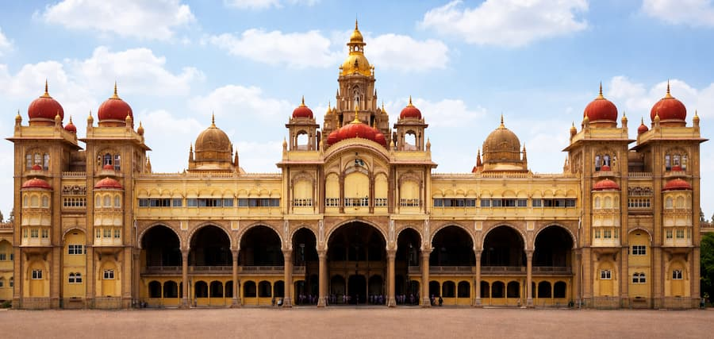
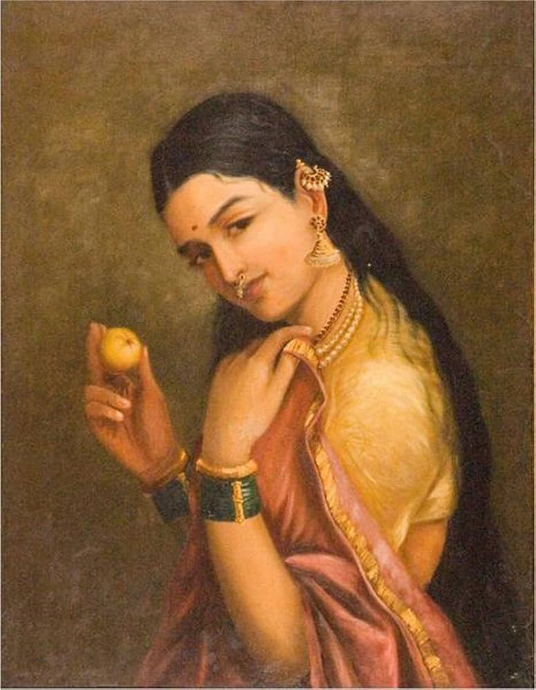
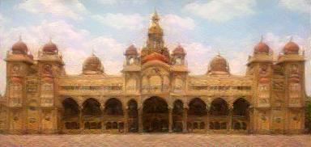

# Neural Style Transfer from Scratch

A PyTorch implementation of the foundational neural style transfer paper,
**"A Neural Algorithm of Artistic Style"** by Gatys, Ecker, and Bethge (2015).

Given a **content photo** and a **style image** (a painting), this program generates
a new image that keeps the *content* of the photo but is rendered in the *style* of
the painting.

> This is the original, optimization-based method. Later work made style transfer
> faster and more flexible (Johnson et al. 2016 for real-time feed-forward
> stylization; AdaIN 2017 for arbitrary styles; diffusion models today). I
> implemented the original paper to understand the core mechanics that every later
> method builds on.

## Example

| Content | Style | Result |
|---------|-------|--------|
|  |  |  |

*(Replace these with your own images once you have results you like.)*

## How it works (in one paragraph)

A convolutional neural network (VGG-19) trained for object recognition learns, at
different depths, to represent an image's **content** (what objects are where) and
its **style** (textures and color patterns). This project freezes VGG-19 and uses
it only as a fixed feature extractor. **Content** is captured by the raw feature
activations at a deep layer (`conv4_2`). **Style** is captured by *Gram matrices*,
which measure how feature channels correlate with each other, discarding spatial
position. We then start from a copy of the content photo and run gradient descent
**on the image's pixels** (not on the network), minimizing a combined loss until
the image matches the photo's content and the painting's style.

The key idea: instead of training a network, we **optimize the image itself** while
the network stays frozen.

## Method details

- **Backbone:** VGG-19, pretrained on ImageNet, feature layers only, frozen.
- **Content layer:** `conv4_2`.
- **Style layers:** `conv1_1`, `conv2_1`, `conv3_1`, `conv4_1`, `conv5_1` (equal weight, 1/5 each).
- **Content loss:** mean squared error between content and generated feature maps at `conv4_2`.
- **Style loss:** mean squared error between the Gram matrices of the style and generated images, summed across the five style layers.
- **Total loss:** `content_weight x content_loss + style_weight x style_loss`.
- **Optimizer:** L-BFGS, optimizing the pixels of the generated image.
- **Initialization:** the generated image starts as a copy of the content photo.

## Requirements

- Python 3.9+
- PyTorch, torchvision, Pillow

Install:

```bash
pip install torch torchvision pillow
```

## Usage

1. Put two images in the project folder, named `content.jpg` and `style.jpg`.
2. Run:

```bash
python main.py
```

3. The result is saved as `result.jpg`.

### Tuning

All dials are at the top of the run block in `main.py`:

- **`OUTPUT_SIZE`** - longest side of the output in pixels. `384` is fast on CPU;
  `512` is sharper; `768` is sharper still but slow and memory-hungry on CPU.
  Note: the output can never be larger than your source images.
- **`style_weight` / `content_weight`** - the balance between style and content.
  A higher `style_weight` makes the result more painterly (less like the photo);
  a higher `content_weight` keeps the photo more recognizable.
- **`steps`** - number of optimization steps. Results usually look most of the way
  there by ~200 steps.

## Notes and limitations

- **Runs on CPU.** It works, but it is slow (a few minutes per image). A GPU would
  be much faster; the code is written for a CPU-only machine.
- **One style, one image at a time.** Each run optimizes a single output from
  scratch; there is no trained model to reuse. This is inherent to the original
  optimization-based method.
- **Resolution/speed/memory tradeoff.** Larger outputs look better but cost more
  time and memory, and you cannot upscale beyond the source image's real size.

## What I learned

- How a pretrained CNN represents content vs. style at different layer depths.
- Why Gram matrices capture style: they measure channel co-occurrence while
  discarding spatial position.
- The difference between **perceptual loss** (comparing images in feature space)
  and raw pixel comparison.
- The core reversal of optimizing the **input image** instead of the model weights,
  with the network frozen.
- Practical PyTorch: tensor shapes, normalization round trips, `requires_grad`,
  and the L-BFGS closure pattern.
- Debugging a real tensor shape-mismatch error.

## Reference

Gatys, L. A., Ecker, A. S., & Bethge, M. (2015). *A Neural Algorithm of Artistic
Style.* arXiv:1508.06576.

## Project files

- `main.py` - the full implementation.
- `GLOSSARY.md` - plain-English definitions of every term used here.
- `NOTES.md` - my working notes while building it.
